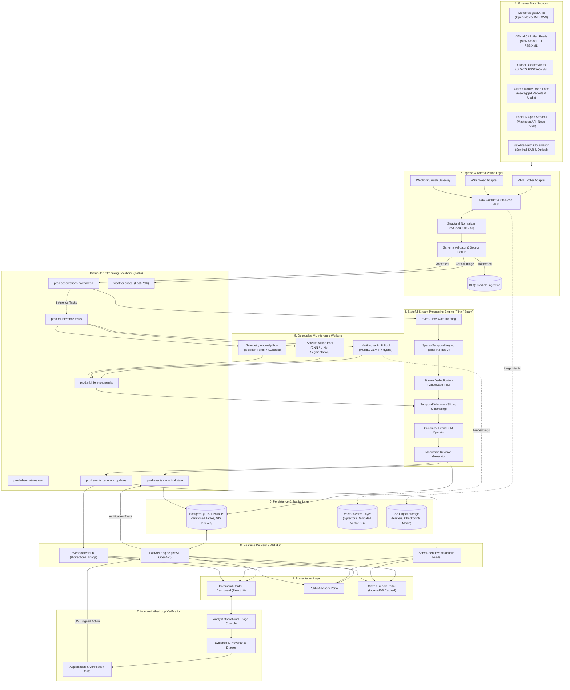
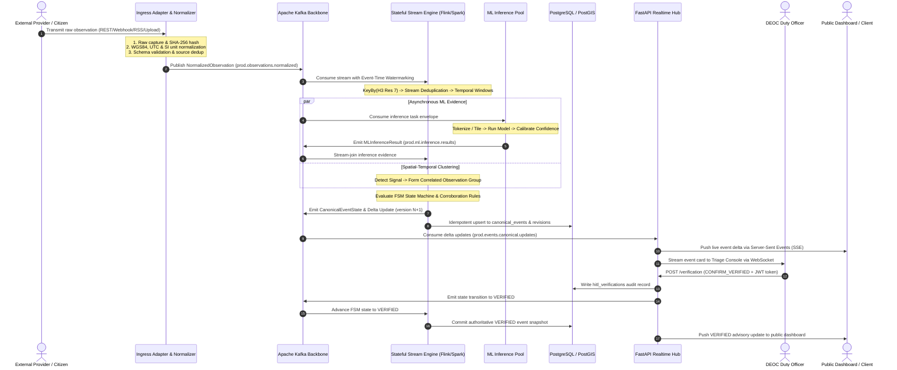
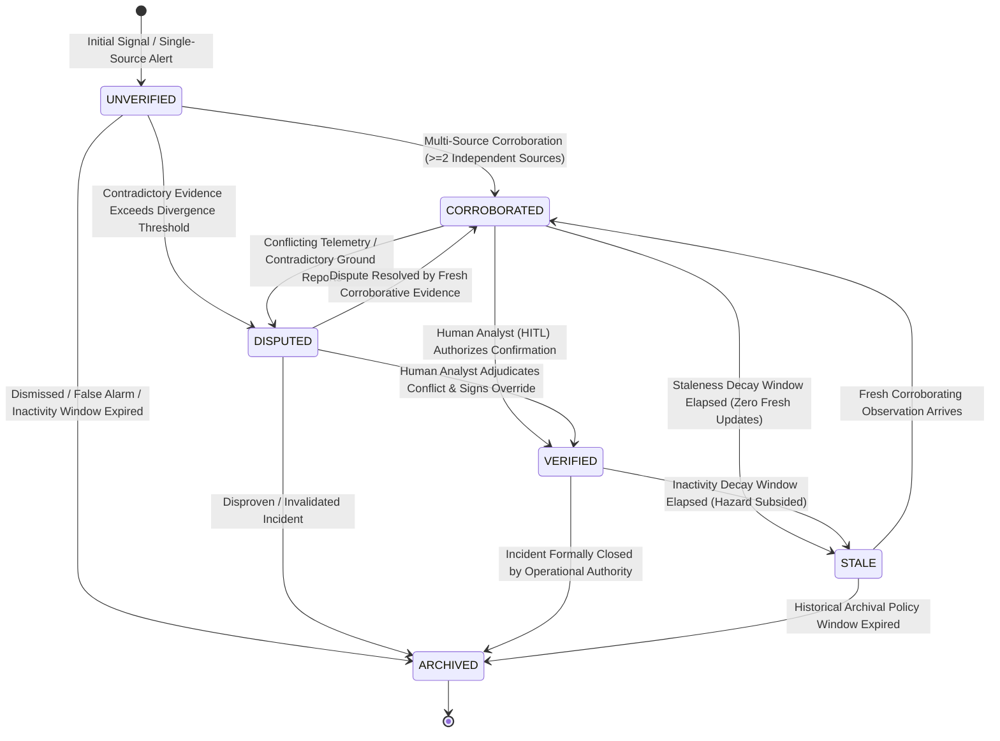
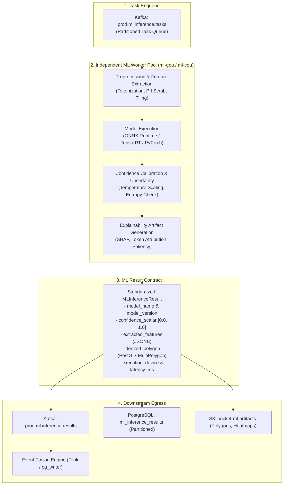
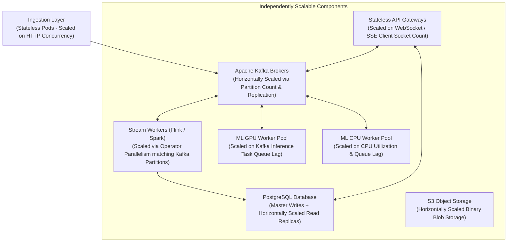
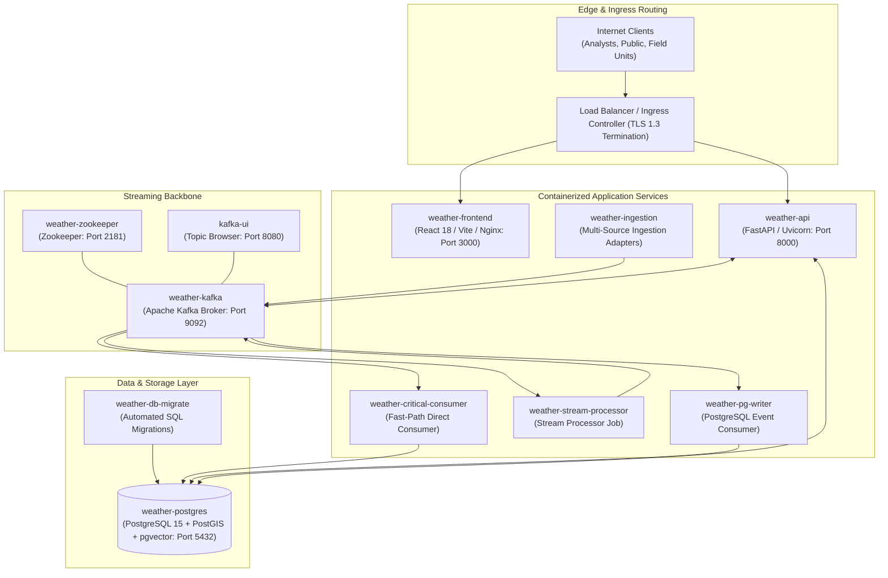

# National Weather & Disaster Intelligence Platform

[](#4-system-architecture)
[](#9-streaming-architecture)
[](#13-storage-architecture)
[](#10-ml--ai-architecture)
[](#12-event-fusion--verification)
[](#15-realtime-api)

A distributed, stateful, event-driven platform designed to ingest, normalize, correlate, enrich, and deliver real-time weather and natural disaster intelligence. The platform aggregates multi-source meteorological telemetry, hydrological gauge streams, Doppler radar rasters, satellite Earth observation imagery, official Common Alerting Protocol (CAP) feeds, and crowdsourced citizen reports into an auditable **Common Operating Picture (COP)** for operational command centers, emergency analysts, and public safety authorities.

---

## Technical Documentation Suite

This `README.md` provides an architectural synthesis of the platform. For deep technical specifications, refer to the canonical technical documents:

| Specification Document | Focus Area & Technical Ownership |
| :--- | :--- |
| [PRD.md](file:///c:/Users/user/OneDrive/Desktop/SIH/antigravity%20md/PRD.md) | Product Requirements, Operational Scope, User Personas, Non-Goals |
| [SystemArchitecture.md](file:///c:/Users/user/OneDrive/Desktop/SIH/antigravity%20md/SystemArchitecture.md) | Distributed Topology, Logical Microservices, End-to-End Pipeline |
| [TechSpec.md](file:///c:/Users/user/OneDrive/Desktop/SIH/antigravity%20md/TechSpec.md) | Cross-Cutting Specifications, Failure Handling, Scalability, Security |
| [DataIngestion.md](file:///c:/Users/user/OneDrive/Desktop/SIH/antigravity%20md/DataIngestion.md) | Source Adapters, Raw Ingress, Normalization, Checkpoints, Ingestion Dedup |
| [StreamProcessing.md](file:///c:/Users/user/OneDrive/Desktop/SIH/antigravity%20md/StreamProcessing.md) | Stateful Processing, Event Time, Watermarking, RocksDB State, FSM |
| [DataSchema.md](file:///c:/Users/user/OneDrive/Desktop/SIH/antigravity%20md/DataSchema.md) | PostgreSQL / PostGIS DDL, Declarative Partitioning, Kafka & JSON Schemas |
| [MLSpec.md](file:///c:/Users/user/OneDrive/Desktop/SIH/antigravity%20md/MLSpec.md) | ML Task Portfolio, Model Selection, Calibration, Uncertainty, Evidence Contracts |

---

## Table of Contents

- [1. Project Header](#national-weather--disaster-intelligence-platform)
- [2. Overview](#2-overview)
- [3. Core Capabilities](#3-core-capabilities)
- [4. System Architecture](#4-system-architecture)
- [5. End-to-End Data Flow](#5-end-to-end-data-flow)
- [6. Four-Tier Data Model](#6-four-tier-data-model)
- [7. Event Lifecycle](#7-event-lifecycle)
- [8. Data Ingestion Architecture](#8-data-ingestion-architecture)
- [9. Streaming Architecture](#9-streaming-architecture)
- [10. ML / AI Architecture](#10-ml--ai-architecture)
- [11. ML Inference Flow](#11-ml-inference-flow)
- [12. Event Fusion & Verification](#12-event-fusion--verification)
- [13. Storage Architecture](#13-storage-architecture)
- [14. Data Schema & Contracts](#14-data-schema--contracts)
- [15. Realtime API](#15-realtime-api)
- [16. Offline-First & Graceful Degradation](#16-offline-first--graceful-degradation)
- [17. Security Architecture](#17-security-architecture)
- [18. Observability](#18-observability)
- [19. Fault Tolerance & Graceful Degradation](#19-fault-tolerance--graceful-degradation)
- [20. Scalability](#20-scalability)
- [21. Production Readiness](#21-production-readiness)
- [22. Deployment Architecture](#22-deployment-architecture)
- [23. Technology Stack](#23-technology-stack)
- [24. Repository Structure](#24-repository-structure)
- [25. Local Development](#25-local-development)
- [26. Configuration](#26-configuration)
- [27. API & Data Examples](#27-api--data-examples)
- [28. Testing](#28-testing)
- [29. Data Governance & Provenance](#29-data-governance--provenance)
- [30. Engineering Principles](#30-engineering-principles)
- [31. Current System Status](#31-current-system-status)
- [32. Limitations](#32-limitations)
- [33. Engineering Roadmap](#33-engineering-roadmap)
- [34. License & Acknowledgements](#34-license--acknowledgements)

---

## 2. Overview

### The Operational Problem
During natural hazards—such as flash floods, severe cyclones, urban inundation, landslides, and extreme weather events—emergency managers face critical information paralysis. Raw field information is:
* **Fragmented:** Siloed across meteorological agencies, hydrological stations, municipal control rooms, satellite feeds, citizen hotlines, and social channels.
* **Heterogeneous:** Straddling binary sensor readings, structured XML alerts, unstructured multilingual text, and multi-spectral GeoTIFF satellite rasters.
* **Noisy and Duplicated:** A single localized disruption triggers thousands of redundant posts and overlapping pings that overwhelm analysts.
* **Contradictory and Unverified:** Eye-witness accounts frequently contradict sensor telemetry or official advisories regarding water levels, road blockages, and damage severity.
* **Static:** Traditional emergency management software stores incidents as static database records, failing to model disasters as dynamic, evolving physical phenomena.

### System Purpose
The platform establishes an automated, evidence-aware pipeline that continuously consumes raw observations, validates and normalizes them, clusters them into candidate signals, correlates multi-source evidence, tracks progressive incident evolution via a formal state machine, and presents an auditable Common Operating Picture (COP) to human analysts.

### Operational Boundaries & Non-Goals
To preserve strict ethical compliance and align with statutory civil defense protocols ([PRD.md](file:///c:/Users/user/OneDrive/Desktop/SIH/antigravity%20md/PRD.md) Section 6):
* **Zero Autonomous Dispatch:** The system never executes autonomous emergency dispatch of rescue units, fire brigades, or ambulances. All deployment mandates authenticated human authorization.
* **Zero Autonomous Public Command:** Automated civil defense sirens, broadcast overrides, or infrastructure actuations (e.g., dam floodgate toggling) are strictly prohibited.
* **ML is Evidence, Never Infallible Truth:** Machine learning outputs represent probabilistic evidence vectors with explicit uncertainty bounds. ML inferences cannot transition an event to `VERIFIED` state without human review.

---

## 3. Core Capabilities

| Capability | Engineering Characteristics | Status | Architectural Anchor |
| :--- | :--- | :--- | :--- |
| **Multi-Source Ingestion** | Protocol-isolated adapters (REST, Webhook, RSS, Blob); raw SHA-256 payload capture; deterministic observation ID generation. | **IMPLEMENTED** | [DataIngestion.md](file:///c:/Users/user/OneDrive/Desktop/SIH/antigravity%20md/DataIngestion.md) |
| **Two-Tier Deduplication** | Edge cryptographic fingerprinting + stream-time spatial-temporal sliding window state deduplication. | **IMPLEMENTED** | [DataIngestion.md](file:///c:/Users/user/OneDrive/Desktop/SIH/antigravity%20md/DataIngestion.md), [StreamProcessing.md](file:///c:/Users/user/OneDrive/Desktop/SIH/antigravity%20md/StreamProcessing.md) |
| **Stateful Event Evolution** | 6-state FSM (`UNVERIFIED` $\rightarrow$ `ARCHIVED`); progressive monotonically incrementing event revisions; merge/split mechanics. | **PRODUCTION-ORIENTED** | [StreamProcessing.md](file:///c:/Users/user/OneDrive/Desktop/SIH/antigravity%20md/StreamProcessing.md), [DataSchema.md](file:///c:/Users/user/OneDrive/Desktop/SIH/antigravity%20md/DataSchema.md) |
| **Geospatial Discretization** | Uber H3 discrete global grid indexing (res 7, 8, 9) for $O(1)$ spatial proximity, ring aggregation, and locality-keyed streaming. | **PRODUCTION-ORIENTED** | [TechSpec.md](file:///c:/Users/user/OneDrive/Desktop/SIH/antigravity%20md/TechSpec.md), [DataSchema.md](file:///c:/Users/user/OneDrive/Desktop/SIH/antigravity%20md/DataSchema.md) |
| **Multilingual NLP** | Text preprocessing, language identification, transformer embeddings (`multilingual-e5-small` / MuRIL / XLM-R), calibrated classification. | **IMPLEMENTED / PRODUCTION-READY** | [MLSpec.md](file:///c:/Users/user/OneDrive/Desktop/SIH/antigravity%20md/MLSpec.md), [MLInference.md](file:///c:/Users/user/OneDrive/Desktop/SIH/antigravity%20md/MLInference.md) |
| **Sensor Anomaly Detection** | Rate-of-rise gradient calculation; Isolation Forest unsupervised telemetry outlier detection. | **ARCHITECTURALLY DEFINED** | [MLSpec.md](file:///c:/Users/user/OneDrive/Desktop/SIH/antigravity%20md/MLSpec.md), [TechSpec.md](file:///c:/Users/user/OneDrive/Desktop/SIH/antigravity%20md/TechSpec.md) |
| **Satellite Hazard Extraction** | CNN scene classification; conditional U-Net encoder-decoder pixel segmentation for floodwater/burn extent delineation. | **ARCHITECTURALLY DEFINED** | [MLSpec.md](file:///c:/Users/user/OneDrive/Desktop/SIH/antigravity%20md/MLSpec.md) |
| **Multi-Source Event Fusion** | Cross-source corroboration counting, credibility scoring, weather agreement verification, spatial/temporal consistency. | **IMPLEMENTED** | [TechSpec.md](file:///c:/Users/user/OneDrive/Desktop/SIH/antigravity%20md/TechSpec.md), [EventFusion.md](file:///c:/Users/user/OneDrive/Desktop/SIH/antigravity%20md/EventFusion.md) |
| **Human-in-the-Loop Triage** | Dedicated adjudication console; evidence/provenance drawer; cryptographically auditable verify/reject/dispute controls. | **IMPLEMENTED** | [PRD.md](file:///c:/Users/user/OneDrive/Desktop/SIH/antigravity%20md/PRD.md), [DataSchema.md](file:///c:/Users/user/OneDrive/Desktop/SIH/antigravity%20md/DataSchema.md) |
| **Realtime Client Delivery** | Requirements-driven transport: Server-Sent Events (SSE) for unidirectional feeds; WebSocket for bidirectional triage operations. | **IMPLEMENTED** | [RealtimeAPI.md](file:///c:/Users/user/OneDrive/Desktop/SIH/antigravity%20md/RealtimeAPI.md) |
| **Offline-First Resilience** | Client-side IndexedDB caching of synchronized state; explicit staleness badges; zero synthetic data fabrication. | **PRODUCTION-ORIENTED** | [TechSpec.md](file:///c:/Users/user/OneDrive/Desktop/SIH/antigravity%20md/TechSpec.md), [PRD.md](file:///c:/Users/user/OneDrive/Desktop/SIH/antigravity%20md/PRD.md) |
| **Data Provenance & Audit** | W3C PROV-DM entity-activity lineage tracking; append-only immutable revision ledgers in PostgreSQL. | **PRODUCTION-ORIENTED** | [DataSchema.md](file:///c:/Users/user/OneDrive/Desktop/SIH/antigravity%20md/DataSchema.md) |
| **Graceful Degradation** | Subsystem fallback matrix: ML failure falls back to rule-based heuristics; DB outage serves read-only cache; zero crash cascades. | **IMPLEMENTED** | [TechSpec.md](file:///c:/Users/user/OneDrive/Desktop/SIH/antigravity%20md/TechSpec.md) |

---

## 4. System Architecture

The platform architecture enforces decoupled operational layers deployed across isolated network zones:



---

## 5. End-to-End Data Flow

The lifecycle of an observation moving through the platform is executed across 14 deterministic stages:



---

## 6. Four-Tier Data Model

To prevent raw, unverified reports from corrupting the authoritative disaster situational picture, the platform strictly segregates data into a **Four-Tier Hierarchy** ([DataSchema.md](file:///c:/Users/user/OneDrive/Desktop/SIH/antigravity%20md/DataSchema.md) Section 2):

```
+----------------------------------------------------------------------------------------------------+
|  TIER 1: RAW OBSERVATION (raw_observations)                                                        |
|  Verbatim payload bytes preserved unmutated; cryptographic SHA-256 hash; source transport context.  |
+----------------------------------------------------------------------------------------------------+
                                                  │
                                                  ▼ (Structural Normalization & Validation)
+----------------------------------------------------------------------------------------------------+
|  TIER 2: DETECTED SIGNAL (detected_signals)                                                        |
|  Normalized physical reading or hazard clue; WGS84 geometry; Uber H3 index; UTC timestamp.         |
+----------------------------------------------------------------------------------------------------+
                                                  │
                                                  ▼ (Spatial-Temporal Window Aggregation)
+----------------------------------------------------------------------------------------------------+
|  TIER 3: CORRELATED OBSERVATION GROUP (correlated_observation_groups)                              |
|  Transient spatial-temporal cluster of related signals within shared H3 cell and temporal window.   |
+----------------------------------------------------------------------------------------------------+
                                                  │
                                                  ▼ (Flink/Spark FSM & Multi-Source Corroboration)
+----------------------------------------------------------------------------------------------------+
|  TIER 4: CANONICAL EVENT (canonical_events)                                                        |
|  Authoritative, living domain aggregate; versioned, confidence-scored, auditable, and actionable.  |
+----------------------------------------------------------------------------------------------------+
```

### Why Each Tier Exists
1. **Tier 1 (Raw Observation):** Guarantees cryptographic provenance and regulatory compliance. If normalization logic contains a bug, raw bytes can be deterministically replayed.
2. **Tier 2 (Detected Signal):** Decouples external provider formats from internal streaming logic. Represents atomic physical measurements (e.g., river stage rate-of-rise) or normalized text extractions.
3. **Tier 3 (Correlated Observation Group):** Maintains spatial-temporal locality in memory without immediately declaring a major disaster incident, preventing premature false alarms.
4. **Tier 4 (Canonical Event):** The persistent, versioned entity representing ground truth. Tracks dynamic spatial footprints, multi-source evidence graphs, and progressive lifecycle states.

---

## 7. Event Lifecycle

Canonical events are modeled as dynamic physical phenomena governed by a **Six-State Finite State Machine (FSM)** ([StreamProcessing.md](file:///c:/Users/user/OneDrive/Desktop/SIH/antigravity%20md/StreamProcessing.md) Section 16):



### State Machine Operational Rules
* **`UNVERIFIED`:** Initial state instantiated from a single high-confidence signal or cluster lacking cross-source corroboration.
* **`CORROBORATED`:** Automatically transitioned by the stream engine when $\ge 2$ independent, compatible source providers (e.g., citizen distress report + nearby hydrological gauge rise) validate the incident within spatial-temporal bounds.
* **`DISPUTED`:** Automatically triggered when incoming telemetry directly conflicts with active reports (e.g., dry river sensor vs. citizen flood claims), elevating triage priority for urgent analyst review.
* **`VERIFIED`:** The human-in-the-loop operational boundary. Requires an explicit, cryptographically authenticated command (`POST /verification`) from an authorized disaster analyst. Automated stream engines **never** autonomously promote an event to `VERIFIED`.
* **`STALE`:** Triggered by event-time decay timers when an active event receives zero corroborating updates for an extended window, preventing zombie incidents on command maps.
* **`ARCHIVED`:** Terminal state representing resolved, closed, or disproven events. Locked against automated state mutation.

### Monotonic Progressive Revisions
Events evolve non-destructively. Every state mutation, evidence attachment, or boundary update increments a monotonic integer `version` ($v_{t+1} = v_t + 1$), writing a full immutable snapshot to `canonical_event_revisions` and emitting a delta update to Kafka.

---

## 8. Data Ingestion Architecture

The Ingestion Layer ([DataIngestion.md](file:///c:/Users/user/OneDrive/Desktop/SIH/antigravity%20md/DataIngestion.md)) isolates the platform from upstream protocol peculiarities and failure modes:

```
[ External Feed ] ──> [ Adapter ] ──> [ Raw Capture ] ──> [ Normalizer ] ──> [ Validator ] ──> [ Kafka ]
                                                                                   │
                                                                                   └──> [ DLQ ]
```

### Ingestion Components & Guarantees
* **Source Registry:** Centralized declarative metadata defining endpoint URIs, Vault secret references, polling cadences, rate limit policies, geographic bounding boxes, and initial source reliability priors ($[0.0, 1.0]$).
* **Source Adapters:** Protocol-isolated connectors running as decoupled workers:
  * `REST Poller`: Scheduled parameterized HTTP pulls with exponential backoff and jitter.
  * `Push Webhook Gateway`: Authenticated JSON/XML ingestion for CAP alerts and citizen apps.
  * `RSS / Feed Adapter`: Periodic GeoRSS parsing with GUID watermarks (GDACS, SACHET).
  * `Object / Blob Ingest`: Streaming download of multi-spectral satellite rasters with chunked integrity validation.
* **Cryptographic Raw Capture:** Verbatim payloads are SHA-256 hashed immediately upon byte receipt ($\text{content\_hash} = \text{SHA256}(\text{bytes})$) and archived in S3 Object Storage (`bucket-raw-observations`).
* **Deterministic Observation IDs:** Generated using UUIDv5:
  $$\text{observation\_id} = \text{UUIDv5}(\text{Namespace\_DNS}, \text{source\_id} + \text{content\_hash})$$
  Ensures that replay or redelivery of identical raw data generates the exact same identifier, guaranteeing downstream idempotent upserts.
* **Source-Level Deduplication:** In-memory sliding window cache tracking deterministic deduplication keys, silently dropping redundant webhook transmissions or repeated polling results.
* **Resumable Checkpoints:** Dual-commit order guarantees **at-least-once** delivery: records are committed to Kafka (`acks=all`) before the adapter commits its read cursor to persistent storage.
* **Dead-Letter Handling:** Malformed payloads failing structural, temporal, or geographic sanity checks are routed to `prod.dlq.ingestion` with diagnostic error traces.

---

## 9. Streaming Architecture

The streaming tier ([StreamProcessing.md](file:///c:/Users/user/OneDrive/Desktop/SIH/antigravity%20md/StreamProcessing.md), [TechSpec.md](file:///c:/Users/user/OneDrive/Desktop/SIH/antigravity%20md/TechSpec.md)) executes distributed stateful event correlation:

### Kafka Topic Backbone & Partitioning
* **Topic Layout:** Partitioned by spatial H3 Resolution 7 index strings (`h3_res7`) or `canonical_event_id`:
  * `prod.observations.normalized`: Ingress stream of validated observation envelopes.
  * `weather.critical`: Fast-path priority triage topic for extreme hazard keywords.
  * `prod.ml.inference.tasks`: Decoupled task queue for GPU/CPU inference worker pools.
  * `prod.ml.inference.results`: Asynchronous inference evidence published by ML workers.
  * `prod.events.canonical.state`: Authoritative full-state snapshots consumed by database sinks.
  * `prod.events.canonical.updates`: Lightweight delta updates powering realtime client feeds.
* **Replication & Producer Semantics:** Kafka brokers enforce replication factor $\ge 3$ and `min.insync.replicas=2`. Producers publish with `acks=all` and idempotence enabled (`enable.idempotence=true`).

### Stateful Processing Engine (Flink / Spark)
* **Event-Time Semantics:** Strict segregation of `observed_at` (real-world event time), `ingested_at` (Kafka arrival time), and `processing_time` (operator system clock).
* **Bounded-Out-Of-Orderness Watermarks:** Advances event time while accommodating network delay:
  $$W(t) = \max(observed\_at) - \Delta_{lateness}$$
* **Late Data Handling:** Moderately late data ($W(t) - \Delta_{allowed} \le t_{obs} \le W(t)$) re-evaluates active windows and emits progressive updates. Severely late data arriving after state purge routes to side outputs (`prod.observations.late`) for historical cold audit.
* **RocksDB State Backend:** Managed state is persisted out-of-core on NVMe storage, decoupled from JVM garbage collection, and snapshotted via asynchronous incremental checkpoints to S3 Object Storage.
* **Spatial Keying (Uber H3):** Stream keying by `h3_res7` ensures all observations within a $\approx 5.1 \text{ km}^2$ locality route to the same processing subtask, enabling $O(1)$ ring expansions without cross-network shuffles.
* **Delivery Semantics:** Internal processing guarantees exactly-once state consistency via distributed checkpoints; external database sinks execute **idempotent upserts** (`ON CONFLICT (canonical_event_id) DO UPDATE`), achieving end-to-end effectively-once semantics.

---

## 10. ML / AI Architecture

The machine learning subsystem ([MLSpec.md](file:///c:/Users/user/OneDrive/Desktop/SIH/antigravity%20md/MLSpec.md)) operates as an out-of-band **probabilistic evidence synthesis engine**. ML outputs never represent unquestionable truth:

```
[ Raw / Normalized Text ] ──> [ NLP Worker ] ──> [ Calibrated Confidence & Entities ] ──┐
[ Satellite Rasters ]     ──> [ Vision Pool ]──> [ Hazard Polygon & Bounding Box ]     ──┼──> [ Event Fusion ]
[ Sensor Telemetry ]      ──> [ Anomaly Pool ]─> [ Isolation Forest Outlier Score ]    ──┘
```

### ML Task Portfolio
1. **Multilingual NLP (ML-TSK-01):**
   * **Scope:** English, Hindi, Marathi, and code-mixed Hinglish (Latin and Devanagari scripts).
   * **Architectures:** Multilingual transformers (MuRIL / XLM-RoBERTa); in the verified codebase, an operational hybrid classifier combines trained TF-IDF + calibrated Logistic Regression with a rule-based negation-aware fallback, supported by `multilingual-e5-small` dense embeddings.
   * **Capabilities:** Incident classification, severity scoring, Named Entity Recognition (NER: locations, casualties, infrastructure damage).
2. **Satellite Earth Observation (ML-TSK-02 & ML-TSK-03):**
   * **Modalities:** Optical multispectral (RGB, NIR, SWIR) and Synthetic Aperture Radar (SAR backscatter VV/VH).
   * **Architectures:** Convolutional Neural Network (CNN) feature backbones for coarse scene classification; encoder-decoder **U-Net** segmentation conditional on tasks requiring pixel-level water or burn boundary delineation.
3. **Telemetry Anomaly Detection (ML-TSK-04):**
   * **Architecture:** Unsupervised **Isolation Forest** tree ensembles evaluating multivariate continuous telemetry (river stages, precipitation rates) where historical disaster labels are sparse.
4. **Structured Severity & Priority Modeling (ML-TSK-05):**
   * **Architecture:** Gradient-boosted decision trees (**XGBoost**) combining sensor readings, NLP outputs, and source pedigree into calibrated Severity & Urgent Need Index (SUNI) rankings.

### Probability Calibration & Explicit Abstention
* **Calibration:** Raw neural network logits and softmax scores are calibrated via Temperature Scaling or Platt Scaling to ensure reported confidence matches empirical true positive probabilities.
* **Abstention:** When inputs exhibit high predictive entropy, severe cloud occlusion, or unsupported language syntax, models emit `INCONCLUSIVE` or `UNCERTAIN`, triggering heuristic fallbacks and routing to human analyst queues.

---

## 11. ML Inference Flow

ML inference is physically and operationally decoupled from client-facing API loops:



* **Model Provenance:** Every inference record permanently binds the input `observation_id` to `{model_name, model_version, dataset_hash, config_hash}`.
* **Failure Handling:** Worker timeouts or GPU out-of-memory errors trigger automatic fallback to conservative rule-based heuristics. The event is tagged `ML_EVALUATION_PENDING` without halting pipeline throughput.

---

## 12. Event Fusion & Verification

The Event Fusion engine ([TechSpec.md](file:///c:/Users/user/OneDrive/Desktop/SIH/antigravity%20md/TechSpec.md) Section 7, [EventFusion.md](file:///c:/Users/user/OneDrive/Desktop/SIH/antigravity%20md/EventFusion.md)) synthesizes heterogeneous evidence into an actionable operational picture:

### Multi-Dimensional Correlation Vectors
Incoming observations are evaluated across five dimensions:
1. **Spatial Correlation:** Uber H3 hexagonal ring proximity ($k\text{-ring} \le 1$ at resolution 8, $\approx 0.7 \text{ km}^2$).
2. **Temporal Correlation:** Sliding window temporal alignment relative to active event timestamps.
3. **Semantic Similarity:** Cosine similarity across multilingual transformer dense embeddings.
4. **Source Reliability Weighting:** Initial prior trust scores attached per source category:
   * Official Meteorological / Hydrological API: $0.95$
   * Official Government Feed (CAP / NDMA): $0.90 - 0.95$
   * Verified News / RSS: $0.75$
   * Crowdsourced Citizen Report: $0.60$
   * Social Media Post: $0.55$
5. **Physical Plausibility Constraints:** Hydrological gradients, elevation topography, and meteorological compatibility rules.

### Credibility & Dynamic Confidence Scoring
Cumulative event confidence is computed via weighted evidence accumulation:
$$C_{t+1} = 1 - (1 - C_t) \cdot (1 - w_i \cdot s_i)$$
Where $C_t$ is existing confidence, $w_i$ is source reliability, and $s_i$ is observation signal confidence.

> [!NOTE]
> In the current codebase implementation, fusion weights across source trust, corroboration count, weather agreement, temporal consistency, spatial consistency, and content quality are **heuristically calibrated engineering weights**, not parameters learned end-to-end by ML.

### Anti-Spam Corroboration Engine
To eliminate coordinated social spam or single-source report flooding:
* Corroboration requires **distinct, independent sources** (different `source_id`, `source_url`, or citizen author).
* Multiple submissions from the same author or device within a 5-minute window are deduplicated before corroboration counting.

### Human-in-the-Loop (HITL) Primacy
Operational verification authority rests exclusively with authorized emergency analysts. Analysts inspect the "Intelligence Provenance & Why" drawer in the dashboard, review contributing evidence and sensor spikes, adjudicate conflicting observations, and submit signed verification decisions.

---

## 13. Storage Architecture

The platform storage topology is partitioned across three specialized datastores ([DataSchema.md](file:///c:/Users/user/OneDrive/Desktop/SIH/antigravity%20md/DataSchema.md)):

```
┌────────────────────────────────────────────────────────────────────────┐
│                      STORAGE & PERSISTENCE TIERS                       │
├───────────────────────────────────┬────────────────────────────────────┤
│ PostgreSQL 15 + PostGIS           │ S3 API Object Storage              │
│ - Authoritative Relational Core   │ - Raw Satellite Rasters (GeoTIFF)  │
│ - WGS84 Spatial Geometries        │ - Citizen Media (Photo, Video)     │
│ - Declarative Range Partitions    │ - Flink Incremental Checkpoints    │
│ - Immutable W3C PROV Ledgers      │ - Serialized ML Model Weights      │
├───────────────────────────────────┴────────────────────────────────────┤
│ Vector Search Layer (Candidate Evaluation)                             │
│ - Candidate A: pgvector (In-database ACID, relational joins)           │
│ - Candidate B: Dedicated Vector DB (Milvus / Qdrant for high QPS)      │
│ * Selected via Phase 3 empirical benchmarking                          │
└────────────────────────────────────────────────────────────────────────┘
```

### PostgreSQL / PostGIS Spatial Indexing
* **Spatial Columns:** Stored as `GEOMETRY(Geometry, 4326)` for hazard polygons and `GEOMETRY(Point, 4326)` for centroids.
* **Index Strategy:**
  * `GIST` indexes on `spatial_geometry` and bounding boxes for sub-millisecond `ST_Contains` and `ST_DWithin` spatial queries.
  * `SP-GIST` indexes on point-only telemetry tables for high-density point clustering.
  * `GIN` indexes on `h3_indices` arrays for instant multi-cell containment queries (`h3_indices && ARRAY['8760e44b5ffffff']`).

### Declarative Table Partitioning
High-volume append tables are partitioned by UTC timestamp ranges to prevent index bloat and support instantaneous historical pruning:
* `raw_observations` & `normalized_observations` $\rightarrow$ Partitioned by range on `observation_timestamp`.
* `canonical_event_revisions` $\rightarrow$ Partitioned by range on `created_at`.
* `canonical_event_state_transitions` $\rightarrow$ Partitioned by range on `transitioned_at`.
* `ml_inference_results` $\rightarrow$ Partitioned by range on `created_at`.
* `audit_log` $\rightarrow$ Partitioned by range on `created_at`.
Partitions older than retention windows are detached (`ALTER TABLE DETACH PARTITION`) and exported to compressed Parquet in cold S3 storage.

---

## 14. Data Schema & Contracts

The platform enforces strict schemas across inter-service contracts ([DataSchema.md](file:///c:/Users/user/OneDrive/Desktop/SIH/antigravity%20md/DataSchema.md)):

### Core Data Models
* **`raw_observations`:** Verbatim payload bytes, SHA-256 content hash, arrival timestamp, transport metadata.
* **`normalized_observations`:** Deterministic UUIDv5 `observation_id`, WGS84 geometry, `h3_res7` index, SI measurements, ISO 8601 UTC timestamps, language code, W3C PROV metadata block.
* **`detected_signals`:** Atomic feature extractions (`GAUGE_STAGE_RISE`, `CITIZEN_DISTRESS`, `THERMAL_HOTSPOT`) with confidence priors.
* **`correlated_observation_groups`:** Transient spatio-temporal clusters with dynamic spatial envelopes and density scores.
* **`canonical_events`:** Living incident entities tracking `version`, `lifecycle_state`, `confidence_score`, `severity_score`, `priority_tier`, PostGIS geometry, centroid, covered H3 cells, and contributing evidence counts.
* **`canonical_event_revisions`:** Immutable historical revision snapshots capturing every mutation with structured delta summaries.
* **`hitl_verifications`:** Legally authoritative audit log tracking analyst user UUIDs, roles, verification actions, severity overrides, and digital signatures.

---

## 15. Realtime API

The API tier ([RealtimeAPI.md](file:///c:/Users/user/OneDrive/Desktop/SIH/antigravity%20md/RealtimeAPI.md)) provides asynchronous query and streaming interfaces:

```
[ Clients ] ──REST──> [ FastAPI Gateway ] ──> [ PostgreSQL / PostGIS ]
     │                                                    │
     ├──SSE─── [ SSE Streaming Hub ] <── Kafka Delta ─────┤
     │                                                    │
     └──WS──── [ WebSocket Hub ]     <── Kafka Delta ─────┘
```

### Representative Verified Endpoints
* `GET /api/v1/health` — Service readiness and dependency health status.
* `GET /api/v1/events` — Filterable, paginated query endpoint for canonical events (filters: category, severity, status, bounding box, time window).
* `GET /api/v1/events/stats` — High-level incident statistics aggregated by category and severity.
* `GET /api/v1/events/{id}` — Full event intelligence view with credibility breakdown, evidence graphs, and revision timeline.
* `GET /api/v1/events/stream` — Unidirectional Server-Sent Events (SSE) streaming live event mutations to dashboards.
* `POST /api/v1/verification` — JWT-protected endpoint for authorized analysts to verify, reject, or flag events.
* `POST /api/v1/citizen-reports` — Multipart submission endpoint for citizen hazard reports and photo attachments.
* `POST /api/v1/auth/login` — OAuth2 / JWT authentication endpoint returning signed bearer tokens.

### Realtime Protocol Separation
* **Server-Sent Events (SSE):** HTTP-native unidirectional streaming dedicated to public dashboards and passive mobile clients. Automatically traverses proxies and supports native browser reconnect via `Last-Event-ID`.
* **WebSocket:** Full-duplex transport dedicated to authorized analysts for interactive event triage, live verification commands, and multi-user cursor locking.

---

## 16. Offline-First & Graceful Degradation

During severe natural catastrophes, telecommunication towers fail, and field networks collapse. The platform implements a strict **offline-first resilience model**:

```
ONLINE STATE
     │
     ▼
Synchronize active events & geographic layers
     │
     ▼
Persist snapshots in browser IndexedDB
     │
     ▼ (Network Disconnect / Cell Tower Outage)
OFFLINE MODE
     │
     ▼
Display previously synchronized data from IndexedDB
- Prominent [OFFLINE / CACHED] status banner
- Explicit "Last Synchronized" timestamp displayed
- ZERO live API calls attempted
- ZERO offline ML inference fabricated
- Citizen reports queued locally in IndexedDB for upload on reconnect
```

### Guarantees of Offline Operation
1. **Previously Synchronized Data Only:** The dashboard displays data cached during the last successful online sync.
2. **Zero Fabricated Weather:** The platform never synthesizes or extrapolates current weather conditions while disconnected. Stale data is prominently badged with its historical observation timestamp.
3. **Local Citizen Submission Buffering:** Reports filed while offline are signed, stored in browser IndexedDB, and automatically dispatched once network connectivity is re-established.

---

## 17. Security Architecture

The platform security framework ([DeploymentObservabilitySecurity.md](file:///c:/Users/user/OneDrive/Desktop/SIH/antigravity%20md/DeploymentObservabilitySecurity.md), [TechSpec.md](file:///c:/Users/user/OneDrive/Desktop/SIH/antigravity%20md/TechSpec.md)) enforces defense-in-depth across all layers:

* **Authentication & Identity Federation:** Built on OpenID Connect (OIDC) and OAuth 2.0. Stateless verification of cryptographically signed JWT bearer tokens.
* **Role-Based Access Control (RBAC):** Strict least-privilege permission matrix:
  * `PUBLIC_USER`: Read-only access to verified alerts and general hazard polygons.
  * `FIELD_RESPONDER`: Geotagged observation submission; access to operational situational maps.
  * `DISASTER_ANALYST`: Triage queue access, corroboration inspection, dispute adjudication, and verification authority.
  * `COMMAND_OFFICER`: Strategic multi-district heatmaps, CAP warning broadcast authorization, operational threshold adjustments.
  * `SYSTEM_ADMIN`: Node health monitoring, connector credential rotation, audit log inspection.
* **Encryption Standards:**
  * *In Transit:* Mandatory TLS 1.3 across all external ingress and internal pod-to-pod communications (mTLS via service mesh).
  * *At Rest:* AES-256 encryption across all PostgreSQL persistent storage volumes and S3 Object Storage buckets.
* **Zero Secrets in Code:** All database credentials, API tokens, and private keys are dynamically injected at runtime via HashiCorp Vault or Kubernetes Secret Store CSI drivers.
* **Citizen Privacy & PII Scrubbing:** Automated regex filters redact mobile numbers and national IDs from text reports before Kafka handoff. Media uploads pass through automated facial and license plate blurring before long-term S3 archival.

---

## 18. Observability

Full-stack observability ([TechSpec.md](file:///c:/Users/user/OneDrive/Desktop/SIH/antigravity%20md/TechSpec.md) Section 14) is implemented using OpenTelemetry (OTel) standards:

```
[ Services & Workers ] ──OTel Spans──> [ OTel Collector ] ──> [ Prometheus / Jaeger ]
        │
        └──Structured JSON Logs (trace_id, event_id)───────> [ Central Log Aggregator ]
```

* **W3C Trace Context Propagation:** Ingestion adapters, Kafka producers/consumers, Flink streaming operators, ML workers, and API gateways inject and extract W3C `traceparent` headers, maintaining unbroken distributed traces across the entire pipeline.
* **Key Monitored Metrics:**
  * *Kafka Lag:* `kafka_consumergroup_lag` per partition, signaling backpressure before memory saturation.
  * *Stream Health:* Flink input watermark progression, checkpoint duration, and RocksDB state size.
  * *ML Health:* Inference task queue depth, worker micro-batch latency, and model memory utilization.
  * *API Health:* HTTP request duration percentiles (p50, p95, p99), SSE client connection counts, and error rates.
* **Structured Logging:** All logs are emitted in JSON format containing unified correlation keys: `trace_id`, `span_id`, `source_id`, and `canonical_event_id`.

---

## 19. Fault Tolerance & Graceful Degradation

The core architectural invariant is: **Failure of an auxiliary component must never cause a total system outage.**

| Subsystem Failure | Detection Mechanism | System Fallback Behavior | Operational Impact |
| :--- | :--- | :--- | :--- |
| **External Source Outage** | Adapter HTTP timeout spikes; zero ingress events. | Circuit breaker trips to `OPEN`; applies exponential backoff with jitter; pipeline processes remaining sources. | Dashboard marks source `OFFLINE`; event confidence recalculates without that feed. Zero pipeline stoppage. |
| **Kafka Broker Loss** | Leader election alarm; producer retry buffer. | Multi-broker cluster elects new partition leader; producers retry safely from memory buffers. | Sub-second latency blip during leader election. Zero committed message loss (`acks=all`, ISR $\ge 2$). |
| **Stream Engine Crash** | TaskManager heartbeat timeout. | Flink JobManager restarts crashed pods and resumes state deterministically from the latest RocksDB S3 checkpoint. | Ingestion buffers in Kafka commit log; processing catches up seamlessly upon restart. |
| **ML Inference Outage** | Worker pod crash; GPU out-of-memory; queue backlog surge. | Tasks remain buffered in Kafka task topics; stream engine applies rule-based heuristic scoring fallback. | Events display provisional confidence with `ML_EVALUATION_PENDING` badge. Progressively updated once ML recovers. |
| **PostgreSQL Primary Crash** | Health probe failure; replication lag spike. | Automated failover promotes standby replica to primary; connection pooler (PgBouncer) redirects write queries. | Write operations pause momentarily during failover; read replicas continue serving public queries. |
| **Network Blackout (Client)** | Browser ping-pong timeout; TCP disconnect. | Frontend switches to cached mode, serving data from IndexedDB; queues citizen submissions locally. | Dashboard displays `[OFFLINE / CACHED]` banner with sync timestamp. Dispatches queued reports on reconnect. |

---

## 20. Scalability

The platform scales independently across all decoupled operational tiers:



### Scaling Mechanisms by Subsystem
* **Kafka Streaming Backbone:** Scales horizontally by increasing topic partition counts and adding broker nodes. Topics are partitioned by `h3_res7` spatial cells, distributing traffic evenly across brokers.
* **Stateful Stream Processing:** Flink task slots scale horizontally to match topic partition counts. RocksDB state is partitioned across worker NVMe drives, avoiding JVM heap saturation.
* **ML Inference Workers:** GPU pools (transformer NLP, satellite CNN) and CPU pools (tokenizers, Isolation Forest) scale independently via Kubernetes Horizontal Pod Autoscaler (HPA) driven by **Kafka Consumer Group Lag** (`kafka_consumergroup_lag`).
* **API Delivery Gateways:** Stateless API pods scale horizontally behind a Layer 7 load balancer based on concurrent client socket connections.
* **Database & Storage Tier:** Relational writes terminate at the primary node; read queries scale across read replicas; time-series tables are partitioned declaratively; large binaries and checkpoint snapshots are offloaded to S3 Object Storage.

> [!IMPORTANT]
> Quantitative capacity targets (events/sec, concurrent users) are designed to scale horizontally with cluster hardware allocation. Production throughput must be verified via deployment-specific benchmarking.

---

## 21. Production Readiness

| Functional Area | Current Engineering State | Repository & Documentation Evidence |
| :--- | :--- | :--- |
| **Ingestion Pipeline** | **Production-Oriented** | Live adapters for Open-Meteo, GDACS RSS, SACHET CAP RSS, Mastodon API, and citizen uploads in `services/ingestion/adapters/`. Priority fast-path triage in `priority_triage.py`. |
| **Stream Processing** | **Production-Oriented** | Spark Structured Streaming pipeline in `services/spark/jobs/stream_processor.py` with 30-min watermark deduplication, spatial clustering, and ML enrichment; Flink architecture specified in `StreamProcessing.md`. |
| **Canonical Event State** | **Production-Oriented** | PostgreSQL database tables `events`, `canonical_events`, `verification_history` managed via migrations in `sql/`. Second-pass cross-source corroboration in `pg_writer.py`. |
| **ML Inference Engine** | **Production-Oriented** | Hybrid classification (TF-IDF + calibrated Logistic Regression with Hindi/English rule-based fallback), `multilingual-e5-small` embeddings, 7-signal semantic deduplication in `services/ml/`. |
| **Realtime Delivery** | **Implemented** | FastAPI backend with SSE streaming (`/events/stream`), paginated event queries, and JWT authentication in `services/api/`. |
| **Human Verification** | **Implemented** | JWT-protected `POST /verification` endpoint; verification history tracking; outbox pattern dispatch in `services/api/services/`. |
| **Geospatial Intelligence**| **Implemented** | PostGIS spatial queries; Leaflet interactive map with cluster layers and category filtering in `services/frontend/src/pages/GeospatialIntelligence.jsx`. |
| **Containerization** | **Production-Ready** | Multi-container Docker Compose stack (11 services) with health checks, automated dependency ordering, and network isolation in `docker-compose.yml`. |
| **Testing & Quality** | **Implemented** | Pytest test suite covering ML classification, credibility scoring, deduplication, and API routes in `tests/`. |

---

## 22. Deployment Architecture

The platform supports both production Kubernetes deployments and local multi-container orchestration:



---

## 23. Technology Stack

| Layer | Technologies Selected | Status & Evidence |
| :--- | :--- | :--- |
| **Frontend Framework** | React 18.3, Vite 5.4, React Router 6.26 | Implemented (`package.json`) |
| **Frontend UI & Styling**| Tailwind CSS 3.4, Lucide Icons | Implemented (`package.json`) |
| **Geospatial Mapping** | Leaflet 1.9, React-Leaflet 4.2 | Implemented (`package.json`) |
| **Data Visualization** | Chart.js 4.4, react-chartjs-2 | Implemented (`package.json`) |
| **Client State Management** | Zustand 5.0 | Implemented (`package.json`) |
| **Backend REST & SSE** | FastAPI (Python 3.10+), Uvicorn | Implemented (`services/api/main.py`) |
| **Authentication** | JWT (JSON Web Tokens), passlib, bcrypt | Implemented (`routers/auth.py`) |
| **Streaming Backbone** | Apache Kafka (Confluent 7.6.1), Zookeeper | Implemented (`docker-compose.yml`) |
| **Stream Processing** | Apache Spark Structured Streaming / Apache Flink | Spark Implemented; Flink Architecturally Defined |
| **Database & GIS** | PostgreSQL 15, PostGIS 3.4, psycopg2 | Implemented (`docker/postgres/Dockerfile`) |
| **Vector Search** | `pgvector` (PostgreSQL Extension) | Implemented (`docker/postgres/Dockerfile`) |
| **Machine Learning** | scikit-learn 1.3.2, sentence-transformers, joblib | Implemented (`services/ml/`) |
| **Dense Embeddings** | `intfloat/multilingual-e5-small` (384 dimensions) | Implemented (`embedder.py`) |
| **External HTTP & RSS** | httpx, feedparser | Implemented (`services/ingestion/adapters/`) |
| **Containerization** | Docker, Docker Compose (11 services) | Implemented (`docker-compose.yml`) |

---

## 24. Repository Structure

```text
SIH26069/
├── .env.example                      # Declarative configuration template
├── docker-compose.yml                # 11-container orchestration definition
├── sql/                              # PostgreSQL DDL and schema migrations
│   ├── 01_init.sql                   # Database initialization and extensions
│   ├── 02_events.sql                 # Observation and event tables
│   └── 03_verification.sql           # HITL verification and audit schemas
├── models/
│   └── event_classifier/             # Trained ML artifacts (model.pkl, metadata.json)
├── training/                         # Offline model training and evaluation scripts
├── services/
│   ├── ingestion/                    # Multi-source ingestion microservice
│   │   ├── main.py                   # Ingestion orchestrator
│   │   ├── priority_triage.py        # Fast-path severity/keyword triage
│   │   ├── critical_consumer.py      # Direct DB writer for critical alerts
│   │   └── adapters/                 # Protocol-specific ingestion adapters
│   │       ├── weather_api.py        # Open-Meteo live weather forecast
│   │       ├── rss.py                # GDACS global disaster RSS feeds
│   │       ├── sachet.py             # NDMA SACHET CAP alert RSS
│   │       ├── social.py             # Mastodon social API integration
│   │       ├── government.py         # data.gov.in / local government data
│   │       ├── citizen.py            # Citizen report normalizer
│   │       └── website.py            # Generic HTML scraper adapter
│   ├── ml/                           # ML intelligence and scoring library
│   │   ├── pipeline.py               # enrich_event() pipeline orchestrator
│   │   ├── classifier/               # Hybrid classifier (trained model + rules)
│   │   ├── dedup/                    # 7-signal semantic duplicate detector
│   │   ├── credibility/              # 6-factor credibility scoring engine
│   │   ├── clustering/               # Spatial-temporal incident clustering
│   │   ├── embeddings/               # Multilingual sentence embeddings
│   │   ├── verification/             # Convergent verification decision engine
│   │   └── explainability/           # Human-readable rationale generator
│   ├── spark/                        # Stream processing jobs
│   │   └── jobs/
│   │       ├── stream_processor.py   # Stream validation, dedup & ML enrichment
│   │       └── pg_writer.py          # Kafka-to-PostgreSQL corroborating sink
│   ├── api/                          # FastAPI backend application
│   │   ├── main.py                   # API entry point & CORS configuration
│   │   ├── dependencies.py           # Database pools & auth dependencies
│   │   ├── routers/                  # API route definitions
│   │   │   ├── events.py             # Event queries, stats, and SSE streaming
│   │   │   ├── verification.py       # Analyst verification actions (JWT)
│   │   │   ├── citizen.py            # Citizen report submission endpoint
│   │   │   └── auth.py               # Authentication and token issuance
│   │   └── services/                 # Outbox and verified consumer daemons
│   └── frontend/                     # React 18 / Vite Common Operating Picture
│       ├── package.json              # Frontend dependencies
│       ├── vite.config.js            # Vite build configuration
│       └── src/
│           ├── App.jsx               # Application routes (11 views)
│           ├── pages/                # Command center, geospatial, verification views
│           ├── components/           # Reusable UI cards, maps, and tables
│           ├── stores/               # Zustand state stores
│           └── api/                  # Axios HTTP client wrappers
└── tests/                            # Pytest automated test suite
```

---

## 25. Local Development

### Prerequisites
* **Docker Desktop** with WSL2 backend (Windows) or native Docker Engine (Linux/macOS).
* Recommended System Resources: Minimum 8 GB RAM allocated to Docker.
* Active Internet Connection (for initial container builds and live weather feeds).

### Step-by-Step Setup
1. **Clone the repository:**
   ```bash
   git clone <repository-url>
   cd SIH26069
   ```

2. **Configure Environment Variables:**
   Copy the template and supply local configuration parameters:
   ```bash
   cp .env.example .env
   ```
   *(Ensure safe database passwords and API tokens are set in `.env` before startup).*

3. **Start the Platform Stack:**
   Launch all 11 orchestrated containers in detached mode:
   ```bash
   docker compose up -d
   ```

4. **Verify Service Health:**
   Wait for services to reach healthy status:
   ```bash
   docker compose ps
   ```

### Web Interfaces & Port Allocation
* **Common Operating Picture (React Dashboard):** `http://localhost:3000`
* **FastAPI Swagger Documentation:** `http://localhost:8000/docs`
* **Kafka UI (Topic Browser):** `http://localhost:8080`
* **Spark Master Web UI:** `http://localhost:8081`

### Running Automated Tests
Execute the unit and integration test suite:
```bash
pytest tests/ -v
```

---

## 26. Configuration

Platform configuration adheres to **Twelve-Factor** methodology, injected via environment variables:

| Variable Name | Description | Default / Example Placeholder |
| :--- | :--- | :--- |
| `POSTGRES_DB` | PostgreSQL database name | `weather_intelligence` |
| `POSTGRES_USER` | PostgreSQL administrative username | `postgres` |
| `POSTGRES_PASSWORD` | PostgreSQL user password | `<change-to-secure-password>` |
| `POSTGRES_PORT` | PostgreSQL database port | `5432` |
| `KAFKA_BOOTSTRAP_SERVERS` | Kafka broker connection string | `weather-kafka:9092` |
| `JWT_SECRET_KEY` | Secret key for JWT signing | `<generate-256-bit-random-secret>` |
| `JWT_ALGORITHM` | Algorithm for token verification | `HS256` |
| `SYNTHETIC_ENABLED` | Enable synthetic seed test events | `false` |
| `MASTODON_API_BASE_URL` | Mastodon instance base URL | `https://mastodon.social` |
| `MASTODON_ACCESS_TOKEN` | Mastodon API client token | `<mastodon-bearer-token>` |
| `GDACS_RSS_URL` | Global Disaster Alert RSS feed | `https://www.gdacs.org/xml/rss.xml` |
| `SACHET_RSS_URL` | NDMA SACHET CAP RSS feed | `https://sachet.ndma.gov.in/cap_public_website/rss/rss_india.xml` |

> [!CAUTION]
> Never commit real passwords, private keys, or API tokens to source control. Production environments must inject credentials dynamically via HashiCorp Vault or Kubernetes Secrets.

---

## 27. API & Data Examples

### Normalized Observation Envelope
```json
{
  "observation_id": "c4b8b6e2-7a2b-4b1e-9a3d-1f2e3d4c5b6a",
  "source_id": "open_meteo_live",
  "source_category": "METEOROLOGICAL",
  "hazard_type": "HEAVY_RAINFALL",
  "observation_timestamp": "2026-09-28T10:15:00.000Z",
  "geometry": {
    "type": "Point",
    "coordinates": [72.8777, 19.0760]
  },
  "h3_res7": "8760e44b5ffffff",
  "physical_measurements": {
    "precipitation_mm": 68.4,
    "temperature_c": 27.8,
    "wind_speed_kmh": 45.2
  },
  "validation_status": "ACCEPTED"
}
```

### Canonical Event Representation
```json
{
  "canonical_event_id": "9b1deb4d-3b7d-4bad-9bdd-2b0d7b3dcb6d",
  "version": 4,
  "lifecycle_state": "CORROBORATED",
  "hazard_category": "FLOOD",
  "confidence_score": 0.885,
  "severity_score": 0.750,
  "priority_tier": "HIGH",
  "spatial_centroid": {
    "type": "Point",
    "coordinates": [72.8820, 19.0810]
  },
  "h3_indices": ["8760e44b5ffffff", "8760e44b4ffffff"],
  "contributing_source_count": 3,
  "first_observed_at": "2026-09-28T09:45:00.000Z",
  "last_observed_at": "2026-09-28T10:20:00.000Z"
}
```

### ML Inference Result
```json
{
  "inference_id": "f81d4fae-7dec-11d0-a765-00a0c91e6bf6",
  "model_name": "hybrid_incident_classifier",
  "model_version": "v1.3.2",
  "confidence_scalar": 0.920,
  "extracted_features": {
    "predicted_category": "heavy_rainfall",
    "detected_entities": ["Kurla", "railway tracks"],
    "rule_override": false
  },
  "inference_latency_ms": 14
}
```

---

## 28. Testing

The codebase implements comprehensive automated testing across core subsystems:
* **ML Classification Tests:** Validates keyword extraction, negation guard behavior, and hybrid classifier fallback logic.
* **Credibility Scoring Tests:** Verifies mathematical clamping of the 6-factor credibility equation and source trust weightings.
* **Deduplication Tests:** Asserts 7-signal composite score accuracy and threshold boundary decisions ($0.85$ probable / $0.60$ possible).
* **Verification Engine Tests:** Validates convergent multi-signal verification decisions (`verified`, `needs_review`, `suspicious`, `duplicate`).
* **API Route Tests:** Verifies HTTP response codes, JSON schemas, JWT authentication, and pagination parameters.

---

## 29. Data Governance & Provenance

* **W3C PROV-DM Alignment:** Every observation envelope encapsulates an immutable `provenance` block recording the generation activity, software adapter version, host agent pod ID, and source content hash.
* **Deterministic Lineage:** Observation UUIDs are derived deterministically using UUIDv5 over source IDs and SHA-256 payload checksums, enabling idempotent reprocessing and lineage verification.
* **Audit Trail Non-Repudiation:** Human verification actions recorded in `hitl_verifications` store mandatory analyst justifications, timestamps, and digital signature hooks.
* **Data Retention Tiers:** Data progresses through 4 tiers: Kafka streaming buffer (7–14 days) $\rightarrow$ Hot PostgreSQL operational store (90–180 days) $\rightarrow$ Warm partitioned tables (1–3 years) $\rightarrow$ Cold compressed Parquet in S3 Object Storage (indefinite archival).

---

## 30. Engineering Principles

The platform architecture is governed by twelve core engineering principles ([SystemArchitecture.md](file:///c:/Users/user/OneDrive/Desktop/SIH/antigravity%20md/SystemArchitecture.md) Section 2):
1. **Event-Driven Architecture (EDA):** State changes propagate as immutable events through durable messaging streams.
2. **Stateful Stream Processing:** Incidents are treated as evolving physical phenomena across temporal windows, not static rows.
3. **Evidence-First Intelligence:** Machine learning outputs represent probabilistic evidence vectors, not authoritative truth.
4. **Human-in-the-Loop (HITL) Primacy:** Operational verification mandates authenticated human review; autonomous dispatch is strictly excluded.
5. **Progressive Event Evolution:** Canonical events are progressively refined through non-destructive, versioned mutations.
6. **Source Independence:** External feeds are treated as untrusted, normalized into uniform envelopes at the boundary.
7. **Loose Coupling & Separation of Concerns:** Decoupled microservices communicating via explicit schema contracts.
8. **Independently Scalable Services:** Heavy GPU/CPU ML pools scale independently from lightweight I/O gateways.
9. **Fault Isolation & Graceful Degradation:** Auxiliary service failures fall back to heuristics without halting core triage.
10. **Deterministic Replayability:** Replayable Kafka logs and checkpoint savepoints enable exact historical recovery.
11. **End-to-End Provenance & Auditability:** Immutable recording compliant with W3C PROV standards for legal accountability.
12. **Requirements-Driven Technology Selection:** Technical choices are justified by measured benchmarks rather than arbitrary preference.

---

## 31. Current System Status

```
[ IMPLEMENTED IN CODEBASE ]
├── Multi-Source Ingestion (Open-Meteo, GDACS RSS, SACHET CAP RSS, Mastodon, Citizen Form)
├── Priority Fast-Path Triage (Direct Kafka & DB write for critical disaster keywords)
├── Spark Structured Streaming (Micro-batching, 30-min watermark deduplication, spatial clustering)
├── Pure-Python ML Library (Hybrid classifier, multilingual-e5-small, 7-signal dedup, 6-factor credibility)
├── PostgreSQL 15 + PostGIS (Spatial indexing, pgvector extension, event & verification schemas)
├── FastAPI REST & SSE (Paginated queries, stats, SSE stream, JWT authentication)
├── React 18 Dashboard (Command center, live event list, geospatial Leaflet map, verification center)
└── Docker Compose Orchestration (11-container local stack with health checks)

[ ARCHITECTURALLY DEFINED IN SPECIFICATIONS ]
├── Apache Flink Production Topology (True event-time watermarking, RocksDB state, FSM process functions)
├── MuRIL / XLM-RoBERTa Deep Transformer Serving (GPU micro-batching, Triton / ONNX runtime)
├── Satellite EO Processing (Multi-spectral rasters, CNN scene classification, U-Net flood delineation)
├── Isolation Forest & XGBoost Daemons (Continuous telemetry anomaly detection & multimodal tabular fusion)
├── Bidirectional WebSocket Triage Subprotocol (/ws/v1/triage for multi-analyst cursor locking)
├── Production Kubernetes Manifests (Dedicated node pools: system, ingest, flink, api, ml-cpu, ml-gpu)
└── OpenTelemetry Distributed Tracing (W3C Trace Context propagation across Kafka)
```

---

## 32. Limitations

1. **Capacity Benchmarking:** Quantitative throughput and consumer group partition counts require empirical stress testing on production hardware.
2. **Model Evaluation Baseline:** The classifier's synthetic test accuracy reflects domain-curated keyword vocabularies; real-world noisy colloquial social media performance requires continuous field retraining.
3. **External Feed Availability:** National agency feeds (IMD, MOSDAC/ISRO) require official governmental credentials not committed to open source; Open-Meteo and public RSS serve as primary live feeds.
4. **SSE Transport Model:** Current SSE delivery polls the database every 2 seconds rather than streaming directly from a Kafka push topic.
5. **Offline Scope:** Offline capability relies on previously synchronized browser IndexedDB state; offline clients cannot receive un-synchronized live alerts until network reconnection.

---

## 33. Engineering Roadmap

Based on the platform execution specifications ([TechSpec.md](file:///c:/Users/user/OneDrive/Desktop/SIH/antigravity%20md/TechSpec.md) Section 24, [ImplementationPlan.md](file:///c:/Users/user/OneDrive/Desktop/SIH/antigravity%20md/ImplementationPlan.md)):
* **Phase 1 (Stream Engine Transition):** Migrate stateful stream processing from micro-batching to Apache Flink for sub-second event-time watermarking and RocksDB managed state.
* **Phase 2 (Deep Multilingual Transformer Serving):** Deploy dedicated GPU inference workers serving fine-tuned MuRIL / XLM-RoBERTa models for vernacular disaster NLP.
* **Phase 3 (Vector Database Benchmark):** Execute empirical benchmark evaluating `pgvector` against dedicated vector engines (Milvus / Qdrant) under peak ingestion workloads.
* **Phase 4 (Satellite Remote Sensing Integration):** Implement automated Sentinel SAR / optical ingestion pipelines with U-Net flood extent segmentation.
* **Phase 5 (Full WebSocket Triage Hub):** Implement the full-duplex `/ws/v1/triage` WebSocket subprotocol for real-time concurrent analyst collaboration.

---

## 34. License & Acknowledgements

* **License:** Licensed under the Apache License, Version 2.0.
* **Data Providers:** Meteorological data courtesy of Open-Meteo; disaster alert feeds courtesy of NDMA SACHET and GDACS.
* **Open Source Foundations:** Built on Apache Kafka, Apache Flink, Apache Spark, PostgreSQL, PostGIS, FastAPI, React, Leaflet, and OpenTelemetry.
